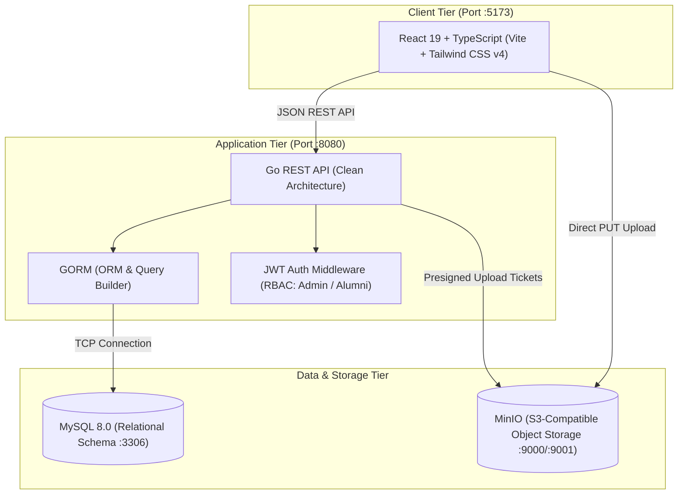

# Alumni Platform: Enterprise Architecture & Cloud Modernization

[](https://golang.org)
[](https://react.dev)
[](https://www.typescriptlang.org)
[](https://www.mysql.com)
[](https://docs.docker.com/compose/)
[](https://min.io)

Modern, containerized cloud-native platform modernizing a legacy collegiate capstone monolith into a production-grade 3-tier architecture.

> **Origin & Evolution**: Re-engineered from the original 2018 collegiate project [James2898/PHP-CI-Alumni-Management-System](https://github.com/James2898/PHP-CI-Alumni-Management-System) (PHP 7.0, CodeIgniter 3.1.10, manual FTP deploys, unconstrained schema). Built as practical proof for **AWS Solutions Architect (SAA-C03)**, **Certified Kubernetes Application Developer (CKAD)**, and **HashiCorp Terraform Associate**.

---

## Architecture Overview



---

## Key Enterprise Architectural Patterns

1. **S3 Presigned URLs (AWS SAA-C03 Pattern)**:
   - File uploads (avatars, resumes) do not pass file bytes through the backend server.
   - The Go server issues a 15-minute cryptographically signed AWS S3 `PUT` ticket, and the browser uploads directly to the MinIO/S3 bucket. Containers stay memory-light and stateless.
2. **Cloud-Native Liveness & Readiness Probes (CKAD Pattern)**:
   - Native `/healthz` (liveness) and `/readyz` (readiness with database socket ping) HTTP endpoints ready for Kubernetes deployment manifests.
3. **Normalized Relational Data Modeling**:
   - Replaced untyped legacy text columns with strict MySQL 8.0 foreign key constraints, UUID primary keys, and bcrypt cryptographic password hashing.
4. **Clean Architecture in Go**:
   - Strict separation across `domain`, `repository`, `service`, `handler`, and `middleware` packages.

---

## Quickstart (Run with Docker Compose)

The entire full-stack platform (Go API, React Frontend, MySQL 8.0, MinIO Storage, and bucket initialization) runs locally with one command:

```bash
# 1. Clone the repository
git clone https://github.com/James2898/alumni-platform.git
cd alumni-platform

# 2. Boot the stack
make up
# or: docker compose up -d --build
```

### Access URLs

| Component | URL | Credentials / Notes |
| :--- | :--- | :--- |
| **Frontend Web App** | [http://localhost:5173](http://localhost:5173) | Vite Dev Server with hot-module reload |
| **Backend REST API** | [http://localhost:8080](http://localhost:8080) | Go API with Air live-reload |
| **Health Liveness Probe** | [http://localhost:8080/healthz](http://localhost:8080/healthz) | Returns `{"status": "healthy"}` |
| **Readiness Probe** | [http://localhost:8080/readyz](http://localhost:8080/readyz) | Verifies MySQL database connectivity |
| **MinIO Storage Console** | [http://localhost:9001](http://localhost:9001) | User: `minioadmin` / Pass: `minioadmin123` |
| **MySQL Database** | `localhost:3306` | DB: `alumni_db` / User: `alumni_user` / Pass: `alumni_secret` |

---

## Seed Accounts

Pre-populated during container initialization from sanitized legacy system records:

* **Administrator**:
  * Email: `admin@alumni.edu`
  * Password: `admin123`
  * Capabilities: Verify pending alumni accounts, manage academic degree programs.
* **Verified Alumni**:
  * Email: `jiro.martinez@alumni.edu`
  * Password: `password123`
  * Degree: BS Information Technology (Class of 2019)
* **Pending Alumni (For Testing Approvals)**:
  * Email: `jolan.clemente@alumni.edu`
  * Password: `password123`
  * Degree: BS Business Administration (Class of 2021)

---

## Project Structure

```text
alumni-platform/
├── backend/                  # Go 1.25+ REST API (Clean Architecture)
│   ├── cmd/api/main.go       # Server entrypoint and route wiring
│   ├── internal/
│   │   ├── config/           # Environment configuration
│   │   ├── domain/           # Models, DTOs, and interfaces
│   │   ├── handler/          # HTTP controllers (Gin)
│   │   ├── middleware/       # JWT auth & CORS guards
│   │   ├── repository/       # GORM MySQL data access layer
│   │   ├── service/          # Business logic layer
│   │   └── storage/          # MinIO / AWS S3 client & presigner
│   ├── .air.toml             # Live-reload configuration
│   └── Dockerfile            # Multi-stage dev & prod builds
├── frontend/                 # React 19 + TypeScript + Tailwind CSS v4
│   ├── src/
│   │   ├── api/              # API client and S3 upload handler
│   │   ├── components/       # Reusable UI components
│   │   ├── context/          # JWT Auth context & state
│   │   ├── pages/            # Directory, Profile, Admin, Auth views
│   │   └── types/            # TypeScript data definitions
│   └── Dockerfile            # Multi-stage Vite dev & Nginx prod
├── database/
│   ├── init/
│   │   ├── 01_schema.sql     # Normalized relational DDL
│   │   └── 02_seed.sql       # Sanitized collegiate seed data
│   └── legacy_alumni.sql     # Original 2018 dump for historical reference
├── docs/
│   └── alumni-platform-master-plan.md  # 4-Milestone Engineering Blueprint
├── docker-compose.yml        # Orchestration linking all 5 services
├── Makefile                  # Developer ergonomics (up, down, logs, test)
└── README.md
```

---

## Developer Commands

```bash
make up         # Build & start all containers in background
make down       # Stop all running containers
make logs       # Follow streaming logs from all services
make db-shell   # Connect to MySQL interactive CLI inside container
make test       # Run Go backend tests & TypeScript frontend builds
make clean      # Destroy containers, network, and data volumes
```

---

## Multi-Milestone Roadmap

- [x] **Milestone 1**: Core Modern Platform (Go API + React 19 + MySQL 8.0 + MinIO S3 + Docker Compose)
- [ ] **Milestone 2**: Kubernetes Orchestration (CKAD: K8s manifests, probes, resource limits, ingress)
- [ ] **Milestone 3**: Infrastructure as Code (Terraform: AWS VPC, S3 media bucket, RDS MySQL)
- [ ] **Milestone 4**: Intelligent AI Capabilities (AWS AI Practitioner: LLM PDF resume parser & skill extractor)

---

## License

MIT © 2026 [James Emmanuel Martinez](https://github.com/James2898).
