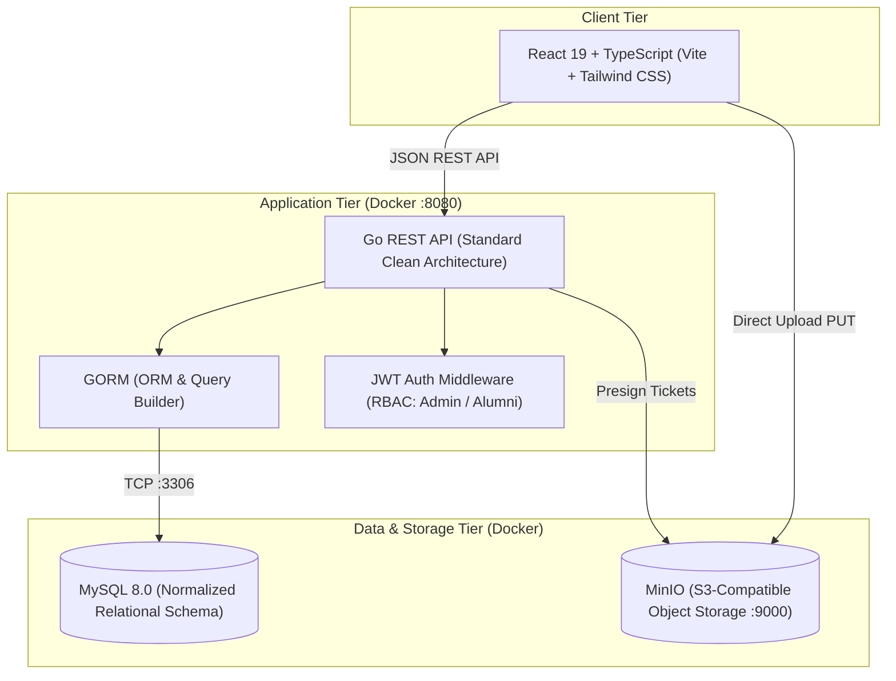
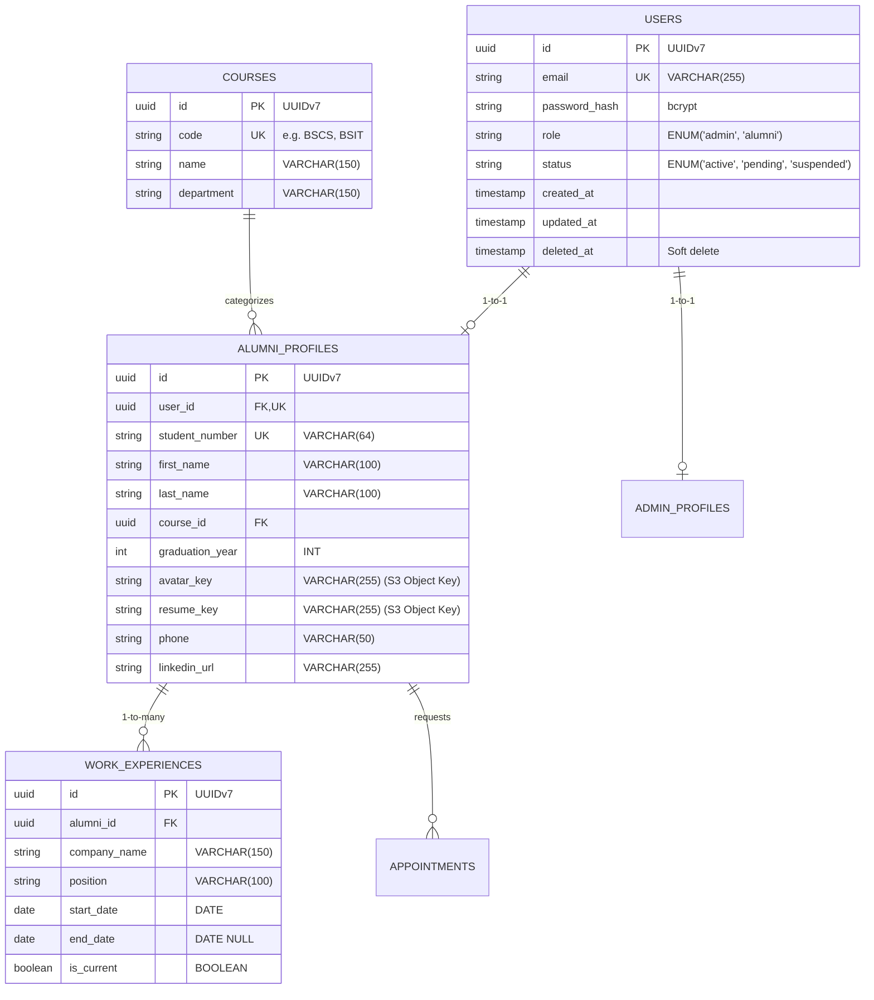
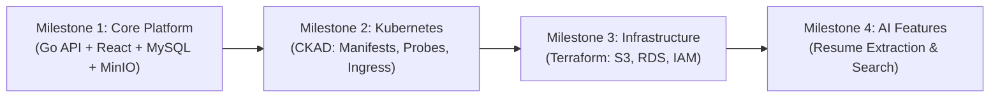

# Alumni Platform: Modernization & Enterprise Architecture Blueprint
*(PHP CodeIgniter &rarr; Go REST API + TypeScript React + Docker + Cloud/DevOps)*

> **Target Audience for this Document**: For AI coding assistants (Claude Code / Antigravity) and human developers starting a new session to execute the modernization of the Alumni Management System.

---

## 1. Project Background & Context

* **Original System**: [James2898/PHP-CI-Alumni-Management-System](https://github.com/James2898/PHP-CI-Alumni-Management-System)
  * Built in 2018/2019 as a collegiate capstone monolith.
  * Stack: PHP 7.0, CodeIgniter 3.1.10, Apache, MariaDB/MySQL (`database/alumni.sql`).
  * Antipatterns in legacy code: All columns stored as untyped `text COLLATE utf8mb4_bin`, no foreign key constraints, passwords stored in plaintext (`admin`, `123`), disjoint polymorphic IDs in `login` table.
* **Modernization Strategy**: **Clean Re-Platforming into a Brand New Repository** (`alumni-platform`).
  * The legacy 2018 repo remains untouched on GitHub as a historical artifact to highlight the "Before vs. After" transformation in the portfolio.
  * The new repo will be built with modern 2026 enterprise standards: Go REST API, GORM, TypeScript + React, Docker Compose, and progressive DevOps/Cloud extensions.
* **Certification Alignment**: The platform is intentionally architected to provide practical, hands-on portfolio proof for targeted certifications:
  * **AWS Solutions Architect – Associate (SAA-C03)**: S3 object storage with presigned URLs, decoupled 3-tier architecture, secrets isolation.
  * **HashiCorp Certified: Terraform Associate**: Declarative Infrastructure as Code (`infra/terraform/`).
  * **Certified Kubernetes Application Developer (CKAD)**: Container orchestration, health probes, K8s manifests (`deploy/k8s/`).
  * **AWS Certified AI Practitioner (AIF-C01)**: Intelligent AI resume parser and alumni skill extraction.

---

## 2. Plain-Language Concept Guide & Why Each Exists

| Technology / Pattern | Plain-English Explanation | What Problem It Solves |
| :--- | :--- | :--- |
| **Docker & Docker Compose** | Shipping containers for software. Packages Go, React, MySQL, and MinIO in isolated boxes so everything runs locally with one command (`docker compose up`) without installing tools directly on the host machine. | Eliminates "works on my machine" issues and config drift. |
| **S3 Presigned URLs** | Instead of having the backend server download and write user images to disk, the Go server gives the browser a temporary 5-minute cryptographic ticket. The browser uploads directly to the storage bucket. | Prevents file uploads from consuming server memory and bandwidth; keeps containers stateless. |
| **MinIO** | A lightweight, free local container that mimics Amazon S3 byte-for-byte. Runs locally in Docker without an AWS account. | Allows testing real enterprise S3 cloud storage for \$0 locally. |
| **Terraform (`.tf`)** | Writing cloud infrastructure as text files instead of manually clicking buttons on the AWS web console. Running `terraform apply` builds it; `terraform destroy` tears it down. | Makes cloud provisioning 100% reproducible and prevents surprise cloud bills. |
| **Kubernetes (CKAD)** | The container orchestrator. Manages multiple container replicas, automatically restarts failed instances, and checks container vitality via `/healthz` and `/readyz` probes. | Industry standard for running resilient, auto-healing container workloads in production. |
| **AI Resume Extractor** | An LLM-powered worker (Claude / AWS Bedrock) that parses uploaded PDF resumes to automatically populate work history, skills, and graduation records. | Modernizes the legacy manual form-filling UX into an intelligent application. |

---

## 3. Target Modern Architecture



---

## 4. Modernized Database Schema (GORM)

Replaces the 2018 unconstrained schema with normalized relational tables:



---

## 5. Phased Execution Roadmap

The implementation is split into **4 sequential, self-contained milestones**:



### Milestone 1: The Core Platform (Starting Point)
* **Goal**: Build a fully functional, containerized local full-stack application.
* **Deliverables**:
  1. Initialize new repo `alumni-platform` with clean monorepo structure:
     * `/backend`: Go 1.22+, GORM, Clean Architecture (`domain/`, `handler/`, `service/`, `repository/`).
     * `/frontend`: React 19, TypeScript, Vite, Tailwind CSS, TanStack Query.
     * `/database`: Initial schema migrations + seed data sanitized from `database/alumni.sql`.
  2. `docker-compose.yml` linking:
     * `alumni-api` (Go with Air live-reload)
     * `alumni-web` (React Vite dev server)
     * `alumni-db` (MySQL 8.0 with persistent volume)
     * `alumni-storage` (MinIO S3-compatible local server)
  3. Authentication & RBAC: JWT Access Tokens + secure Refresh Cookies, bcrypt password hashing.
  4. Core Feature Set:
     * Alumni registration, login, profile edit, and avatar upload via S3 presigned URL.
     * Filterable Alumni Directory (filter by course, batch year, company).
     * Admin Dashboard (verify pending accounts, manage courses).

### Milestone 2: Kubernetes Orchestration (CKAD)
* **Goal**: Enable production-ready container management.
* **Deliverables**:
  1. `/deploy/k8s/` manifests: Deployments, Services, ConfigMaps, Secrets, Ingress.
  2. Implement native Go `/healthz` (liveness) and `/readyz` (readiness) HTTP endpoints checking database connectivity.
  3. Define resource requests and limits (`cpu: 100m`, `memory: 128Mi`) to satisfy CKAD patterns.
  4. Test locally using **Kind** or **Minikube** inside Docker for \$0.

### Milestone 3: Infrastructure as Code (Terraform)
* **Goal**: Automate cloud provisioning for AWS.
* **Deliverables**:
  1. `/infra/terraform/` modular architecture:
     * `modules/s3`: S3 media bucket with private ACLs and CORS.
     * `modules/rds`: AWS RDS MySQL instance with security groups.
     * `modules/network`: VPC, public/private subnets.
  2. Support dry-run testing via `terraform plan` and LocalStack without incurring AWS costs.
  3. Provide `make tf-destroy` guardrails to prevent accidental cloud spend.

### Milestone 4: Intelligent AI Capabilities (AWS AI Practitioner)
* **Goal**: Embed intelligent agentic features into the application.
* **Deliverables**:
  1. S3 Resume PDF upload pipeline.
  2. Go AI background service using Claude API or AWS Bedrock to extract structured profile JSON from raw PDF text.
  3. Auto-populate alumni work history and skills from the AI response.

---

## 6. How to Kick Off the Next Session

When handing this document to an AI assistant or starting a new session:

1. **Create the New GitHub Repo**:
   ```bash
   gh repo create alumni-platform --public --description "Modernized Alumni Management Platform - Go, TypeScript React, Docker, and Cloud-Native DevOps"
   ```
2. **Provide this Instruction**:
   > *"We are executing Milestone 1 of `docs/alumni-platform-master-plan.md`. Please initialize the repository structure with Go backend, React TypeScript frontend, MySQL 8.0, MinIO S3 storage, and the `docker-compose.yml` file."*
