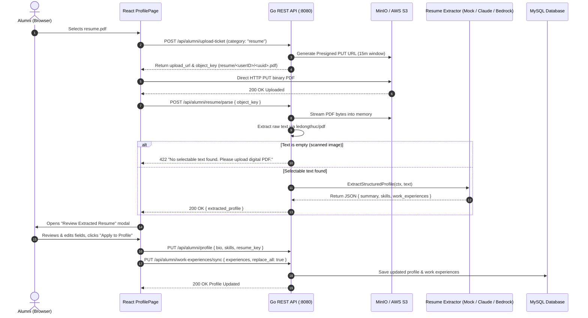

# Milestone 4: Intelligent AI Capabilities — Design Specification

## Overview
This document captures the finalized architectural design, technical decisions, and implementation plan for **Milestone 4: Intelligent AI Capabilities (AWS AI Practitioner Alignment)**, established through comprehensive design grilling.

---

## 1. Architectural Decisions Matrix (Grill Record)

| Decision Area | Selected Approach | Rationale |
| :--- | :--- | :--- |
| **AI Provider Strategy** | Extensible `ResumeExtractor` Go interface supporting Anthropic Claude API / AWS Bedrock, with a built-in deterministic **Mock Extractor** ($0 offline mode). | Allows full end-to-end development, local testing, and automated CI validation without requiring paid API keys or cloud spend. |
| **Parsing Execution Pattern** | Synchronous REST endpoint: `POST /api/alumni/resume/parse`. | Provides immediate user feedback (~2-3s response) without requiring complex background worker queues or WebSocket/polling status overhead. |
| **Profile Mutation Safety** | Interactive **"Review Extracted Resume"** modal in frontend before database commit. | Prevents LLM hallucinations or unintentional overwrites of existing bio or custom work experiences without user verification. |
| **Skills Storage** | Comma-separated `skills` column (`VARCHAR(500)`) on `alumni_profiles` table. | Lightweight, backward-compatible, auto-migrated via GORM, directly indexed/searchable in SQL. |
| **PDF Text Extraction** | Pure-Go PDF text extractor (`github.com/ledongthuc/pdf`) in-memory from MinIO/S3 stream. | Avoids heavy external OCR binaries (e.g. Tesseract) and keeps Docker container size small. |
| **Scanned/Image PDF Handling** | HTTP 422 Unprocessable Entity with descriptive error message if extracted text is empty. | Clear UX guidance to upload digital PDFs while preventing unnecessary LLM token waste on empty text. |
| **Work Experience Sync** | Modal provides a default checked toggle: `[x] Replace existing work experiences`, which can be unchecked to append. | Gives users explicit control over whether to refresh or accumulate career history. |
| **Resume Object Privacy** | Strictly private S3 ACL; 15-minute presigned GET download tickets via `GET /api/alumni/:id/resume-url`. | Protects alumni PII (address, phone, personal contacts) from public exposure (unlike avatars). |
| **Storage Lifecycle** | Automatic deletion of previous `resume_key` S3 object when saving a new resume. | Prevents unbounded orphan file accumulation in MinIO/S3 storage. |
| **Directory Search & UI** | Directory search extended to match against `skills`; alumni cards display up to 3 compact skill badges with a `+N more` counter. | Enables skills-based alumni networking and recruitment filtering. |

---

## 2. Target Component Architecture



---

## 3. Data Contracts & Schema Updates

### Database Schema Changes
Add to `alumni_profiles`:
```sql
ALTER TABLE alumni_profiles ADD COLUMN skills VARCHAR(500) NULL AFTER bio;
```

### Go Models (`backend/internal/domain/models.go`)
```go
type AlumniProfile struct {
    // ...
    Bio       string `gorm:"type:text" json:"bio"`
    Skills    string `gorm:"type:varchar(500)" json:"skills"`
    // ...
}
```

### Extraction DTOs (`backend/internal/domain/dto.go`)
```go
type ParseResumeRequest struct {
    ResumeKey string `json:"resume_key" binding:"required"`
}

type ExtractedWorkExperience struct {
    CompanyName string `json:"company_name"`
    Position    string `json:"position"`
    StartDate   string `json:"start_date"` // YYYY-MM
    EndDate     string `json:"end_date"`   // YYYY-MM or null
    IsCurrent   bool   `json:"is_current"`
}

type ExtractedResumeResponse struct {
    Summary         string                    `json:"summary"`
    Skills          []string                  `json:"skills"`
    WorkExperiences []ExtractedWorkExperience `json:"work_experiences"`
}

type SyncWorkExperiencesRequest struct {
    Experiences []ExtractedWorkExperience `json:"experiences"`
    ReplaceAll  bool                      `json:"replace_all"`
}
```

---

## 4. Implementation Steps for Next Session

1. **Backend Storage & Domain Extensions**:
   - Add `GetObject` and `GeneratePresignedDownloadURL` to `backend/internal/storage/minio.go`.
   - Update `domain.AlumniProfile` with `Skills string`.
   - Add DTOs for resume parsing and work experience synchronization.

2. **AI Extractor Package (`backend/internal/ai/`)**:
   - Define `ResumeExtractor` interface.
   - Implement `MockResumeExtractor` (deterministic fallback for \$0 testing).
   - Implement `ClaudeResumeExtractor` / `BedrockResumeExtractor` using standard HTTPS or AWS SDK.
   - Implement pure-Go PDF text parsing helper (`backend/internal/ai/pdf_parser.go`).

3. **Backend Service & Handlers**:
   - Implement `ParseResume` and `SyncWorkExperiences` in `alumni_service.go` and `alumni_repository.go`.
   - Add route `POST /api/alumni/resume/parse` (protected by alumni auth).
   - Add route `PUT /api/alumni/work-experiences/sync` (protected by alumni auth).
   - Add route `GET /api/alumni/:id/resume-url` (protected, checks owner/admin).
   - Extend directory list query to filter across `skills`.

4. **Frontend UI Integration**:
   - `ProfilePage.tsx`: Add Resume Upload dropzone + S3 upload ticket handling.
   - Add "Review & Confirm" modal component for extracted resume data.
   - Add Skills input tag editor in Edit Profile form.
   - `DirectoryPage.tsx`: Render top 3 skill tags on alumni cards and enable skill search.
